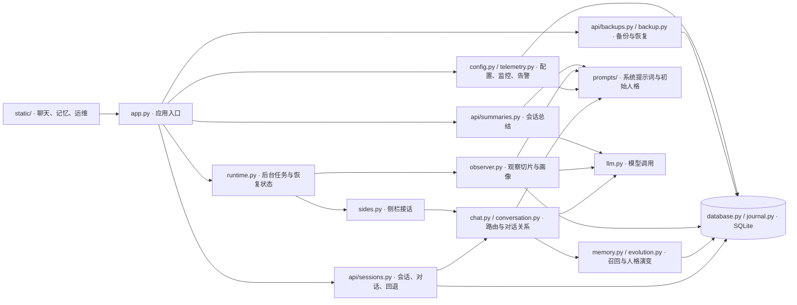

# 想法簿

一个本地运行的想法群聊。发出的念头进入主聊，朋友之间的接话放在「交头接耳」侧栏。后台观察器从用户原话积累记忆。

## 启动

需要 Python 3.11 以上和 [uv](https://docs.astral.sh/uv/)。

```sh
uv sync
uv run uvicorn thought_app.app:app --host 127.0.0.1 --port 8000
```

打开 [http://127.0.0.1:8000](http://127.0.0.1:8000)。首次启动会预置 DeepSeek V4.1 Flash（`deepseek-flash`），以及造梦师、刺头、拾荒者和影子自我。

预置 DeepSeek API 从本地 `.env` 读取 `DEEPSEEK_API_KEY`。也可以在运维后台填写密钥，适用于 DeepSeek 和采用 OpenAI Chat Completions 格式的接口。为兼容接口填服务的基础地址，比如 `https://api.example.com/v1`。

在本地 `.env` 设置 `POE_API_KEY` 后，启动时会将 Poe 和 `deepseek-v3.2` 加入可选模型。这个密钥仅用于 `https://api.poe.com/v1`。

## 使用

- **主聊**：一个词也可以发，值得展开的想法也可以聊上几段。路由根据话题挑选一到两位角色，可以用 `@角色名` 直接点名。角色有时会附一句可展开的虚构旁白。
- **交头接耳**：围绕第一条主聊回复，系统有时会请另一位朋友补充或提出不同意见，自动接话最多两条。手动邀请时，从「接哪句话」选本轮原话，再选「请人插嘴」。接你的消息会直接回你，接朋友的消息就回那位朋友。点「停一下」或发新消息可以打断正在生成的侧栏接话。主聊与侧栏共用带发言人和回复关系的历史，聊回旧话题时会按内容找回相关原话和接话。
- **观察器和影子自我**：观察器异步整理你原话里的情绪、观点、价值和关联，附原文出处，在「记忆」里可见。朋友只会取少量相关切片。点名影子自我，会根据你的原话和已积累的记录组装参考画像，给出一个带依据的第一人称视角。
- **回退重跑**：在自己的消息旁点「回退到这条」，确认后从该消息起撤回后续对话，并把这条原话放回输入框。受影响的总结会移除，自动人格更新也会随对应发言撤回。刷新后仍可用这条草稿重跑。
- **记忆**：打开一个会话，选择总结模型并生成总结。可以修改内容、重新生成，以及设置是否供其他会话引用。覆盖范围外出现新消息时，总结会标为待更新。
- **跨会话引用**：下一次聊天会按标题和关键词挑选最多三条已开启引用的总结。聊天里可以打开相关会话，带原话引用的回复可以跳到对应消息。
- **运维**：在机器人配置里选择 API 及其模型。「长回答」默认关闭，回复长度按话题自适应。开启后，主聊和侧栏接话都会优先展开。聊天消息可展开「调用信息」查看实际用到的 API 和模型。运维的「监控」可按时间、API 和模型筛选调用次数、耗时与供应商回传的 Token；「告警」可查看和确认超时、额度不足等故障。
- **人格演变**：在「运维 → 机器人 → 人格演变」查看三位朋友从实际发言里留下的观点、兴趣和习惯。每条记录都有出处，观点更新后可以回看之前的版本。暂停自动更新会保留已有记录供该角色使用，也可以单独删除记录。影子自我的画像来自观察器。

数据保存在 `.data/thoughts.sqlite3`。可以用 `THOUGHT_DB` 指定其他文件，方便隔离测试。聊天和生成总结时，所选外部模型会收到完成任务所需的会话内容和相关记忆片段。

## 项目结构



- `thought_app/prompts/personas/` 中每个人格有独立的 Markdown 模板。模板用于新建默认角色及既有的升级迁移。已经在运维中配置的角色以数据库里的设定为准，可以在「人格模板」中编辑。
- 路由、主聊、侧栏、影子自我、观察器和总结的提示词在 `thought_app/prompts/`。服务启动时读取文件。
- `thought_app/api/` 管理会话、总结和备份的 HTTP 入口。模型调用、记忆召回与人格演变各自留在对应的模块。

## 备份与恢复

打开「运维 → 备份」。导出会下载一份版本化的 ZIP，包含会话、总结、观察切片、人格设置与演变、回退草稿，以及本地配置和运维记录。备份含有私人对话，适合单独保管。API 密钥和 `.env` 留在本机。

导入会替换本机的应用数据。应用会先校验文件，再在数据库同级的 `backups/` 保存一份导入前快照，并在一个事务里恢复数据。名称、协议和地址相同的 API 配置会沿用本机已保存的密钥。换机恢复后，可以在本地填写所需的密钥。默认的保护快照目录是 `.data/backups/`。

## 回归测试

```sh
uv run python -m unittest discover -s tests -v
```

测试使用临时数据库和模拟模型调用。
