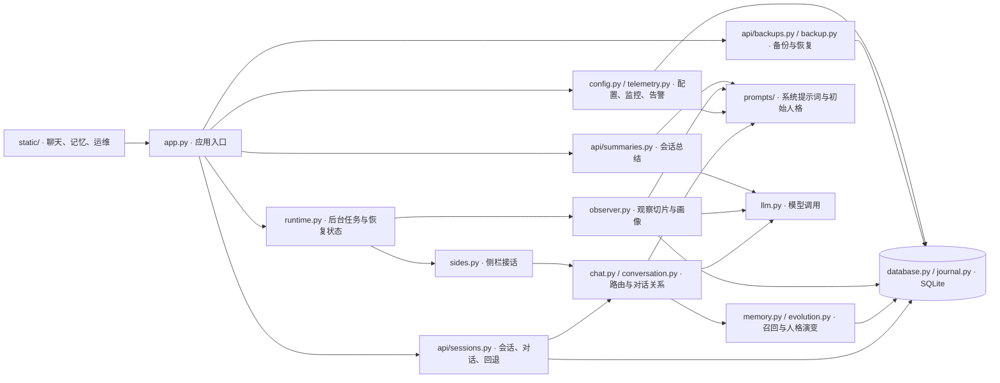

# 想法簿

一个本地运行的想法群聊。发出的念头进入主聊，朋友之间的接话放在「交头接耳」侧栏。后台观察器从用户原话积累记忆。

## 启动

需要 Python 3.11 以上和 [uv](https://docs.astral.sh/uv/)。

```sh
uv sync
uv run uvicorn thought_app.app:app --host 127.0.0.1 --port 8000
```

打开 [http://127.0.0.1:8000](http://127.0.0.1:8000)。首次启动会预置 DeepSeek V4.1 Flash（`deepseek-flash`），以及造梦师、刺头、拾荒者、影子自我、自我分析心理学专家和社会科学分析专家。

预置 DeepSeek API 从本地 `.env` 读取 `DEEPSEEK_API_KEY`。也可以在运维后台填写密钥，适用于 DeepSeek 和采用 OpenAI Chat Completions 格式的接口。为兼容接口填服务的基础地址，比如 `https://api.example.com/v1`。

在本地 `.env` 设置 `POE_API_KEY` 后，启动时会将 Poe 和 `deepseek-v3.2` 加入可选模型。这个密钥仅用于 `https://api.poe.com/v1`。

## 加载 Demo

仓库内的 [demo.sql](demo/demo.sql) 包含会话、角色和记忆，可导入一个独立的 SQLite 数据库来体验。以下命令会为本次演示创建一个新的数据库文件。

```sh
demo_dir="$(mktemp -d)"
sqlite3 "$demo_dir/thought-demo.sqlite3" < demo/demo.sql
THOUGHT_DB="$demo_dir/thought-demo.sqlite3" uv run uvicorn thought_app.app:app --host 127.0.0.1 --port 8001
```

打开 [http://127.0.0.1:8001](http://127.0.0.1:8001) 浏览已有对话和记忆。要生成新回复，可在本地 `.env` 或「运维 → API 与模型」填写自己的 API 密钥。

## 使用

- **Markdown**：对话、记忆正文和角色介绍支持标题、列表、强调、引用、链接、代码和简单表格。编辑时可继续使用 Markdown 原文。
- **Agent 群聊**：角色在开口前根据编译后的人格决定如何回应。普通群友可以按技能召回私有记忆，即使没发言也能记下一条有原话出处的约定或界限。影子自我使用用户自己的表达，专家可使用兼容的联网工具。对话页的「角色介绍」可以查看当前角色的人格，消息的「调用信息」记录使用的人格版本。
- **历史库**：明确问「翻一下之前的聊天」可以查旧话。命中多个轮次时会按本轮问题归纳，回复可跳回原话。会话原话默认限本会话检索，可在「记忆 → 会话」打开「允许其他会话检索原话」。撤回来源时，一并撤回直接依赖该来源的 Agent 回复。
- **运维 → 配置**：「API 与模型」负责接入服务、配置模型和联网调试。「Agent」中直接新建角色，可以自行填写人格，或复制一份角色示例后修改。每个角色独立保存人格和编译版本，修改后在该角色的「人格与技能」里重新编译。支持 Thinking 的模型可为单个角色覆盖行动判断、检索和回复生成的强度，编译继续使用全局设置。

- **主聊**：路由结合这轮的意图和情绪强度选人，并为每位参与的 Agent 判断回应深度和主动程度。你也可以用 `@角色名` 直接点名，或在消息里说希望怎么聊。角色有时会附一句可展开的虚构旁白。
- **交头接耳**：围绕第一条主聊回复，系统有时会请另一位朋友补充或提出不同意见，自动接话最多两条。手动邀请时，从「接哪句话」选本轮原话，再选「请人插嘴」。接你的消息会直接回你，接朋友的消息就回那位朋友。点「停一下」或发新消息可以打断正在生成的侧栏接话。主聊与侧栏共用带发言人和回复关系的历史，聊回旧话题时会按内容找回相关原话和接话。
- **专家人格**：两位专家默认启用，在 Agent 工作区可以分别启停。点名专家或由路由邀请后，使用官方 DeepSeek 的 `deepseek-flash` 时，专家可以按需联网核实研究和数据，也可以读取你发来的网页。网页出处随回复显示。运维的「网页搜索」可以选择专家提交问题或链接，并查看实际搜索与读页次数。手动查询无需创建会话。
- **观察器和影子自我**：观察器异步整理你原话里的情绪、观点、价值和关联，附原文出处，在「记忆」里可见。朋友只会取少量相关切片。点名影子自我，会根据你的原话和已积累的记录组装参考画像，给出一个带依据的第一人称视角。
- **回退重跑**：在自己的消息旁点「回退到这条」，原位编辑后点「保存并重跑」。后续对话随之撤回，群友用编辑后的消息重新接话。受影响的总结和自动人格更新会随对应发言撤回。
- **记忆**：打开会话可看到原话和接话构成的树。每条默认只显示预览，点开可读全文，也可以展开或收起全部。编号按发言发生顺序排列，插嘴单独标明，分支跟随它所回复的那句话。总结、观察切片和历史共享设置与对话树一起保留。
- **跨会话引用**：下一次聊天会按标题和关键词挑选最多三条已开启引用的总结。聊天里可以打开相关会话，带原话引用的回复可以跳到对应消息。
- **运维**：聊天消息可展开「调用信息」查看实际使用的模型。使用监控可按时间、API 和模型筛选调用次数、耗时与 Token，告警用于查看超时和额度不足等故障。
- **模型调用测试**：在 Agent 工作区测试所选模型，会发一条简短的请求并显示耗时、HTTP 状态和 Token 用量。
- **路由与回退**：在 Agent 工作区分别选择路由模型和格式回退模型。两个设置都可以留空。
- **人格演变路径**：在「运维 → Agent」选中角色，打开「人格演变路径」。一条有原话支持的偏好可以形成或修订注意、行动判断或表达技能。展开记录可以对照前后描述和技能，跳到来源发言。对话页的「角色介绍」显示当前偏好。支持暂停新增、删除记录和回退来源。影子自我的画像来自观察器。

数据保存在 `.data/thoughts.sqlite3`。可以用 `THOUGHT_DB` 指定其他文件，方便隔离测试。聊天和生成总结时，所选外部模型会收到完成任务所需的会话内容和相关记忆片段。

## 项目结构



- `thought_app/prompts/personas/` 中每个人格有独立的 Markdown 模板。模板用于新建默认角色及既有的升级迁移。已经在运维中配置的角色以数据库里的设定为准，可以在「人格模板」中编辑。
- 路由、主聊、侧栏、影子自我、观察器和总结的提示词在 `thought_app/prompts/`。服务启动时读取文件。
- `thought_app/api/` 管理会话、总结和备份的 HTTP 入口。模型调用、记忆召回与人格演变各自留在对应的模块。

## 备份与恢复

打开「运维 → 备份」。导出会下载一份版本化的 ZIP，包含会话、总结、观察切片、人格设置与演变、回退草稿，以及本地配置和运维记录。备份含有私人对话，适合单独保管。API 密钥和 `.env` 留在本机。

导入会替换本机的应用数据。应用会先校验文件，再在数据库同级的 `backups/` 保存一份导入前快照，并在一个事务里恢复数据。名称、协议和地址相同的 API 配置会沿用本机已保存的密钥。换机恢复后，可以在本地填写所需的密钥。默认的保护快照目录是 `.data/backups/`。

## 回归测试

```sh
uv run python -m unittest discover -s tests -v
```

测试使用临时数据库和模拟模型调用。
